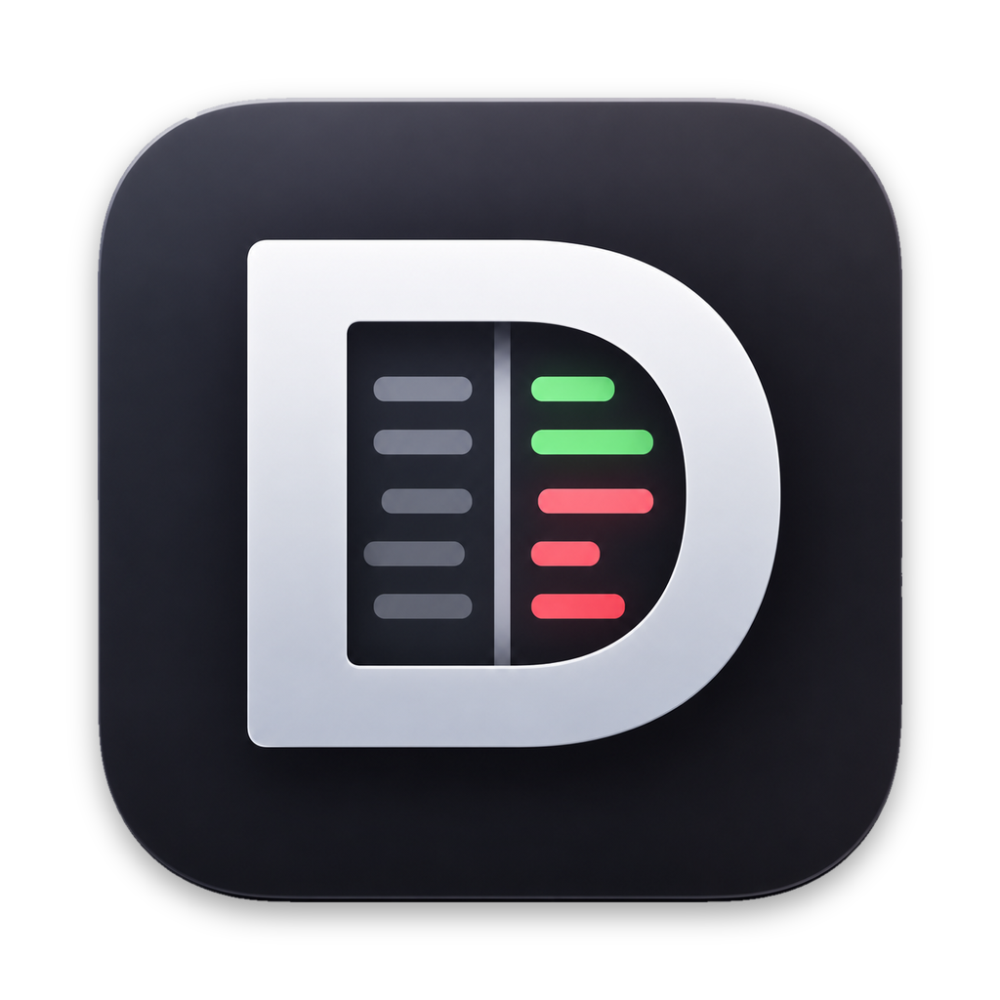
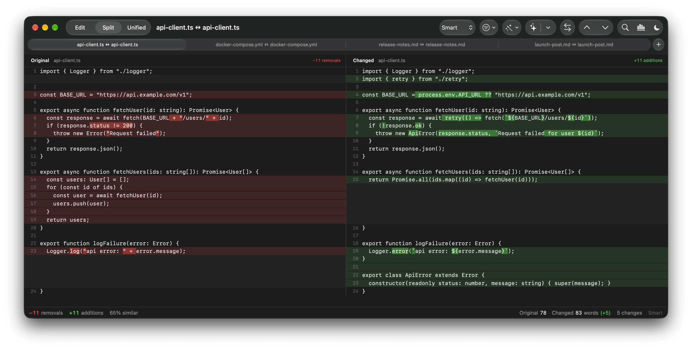
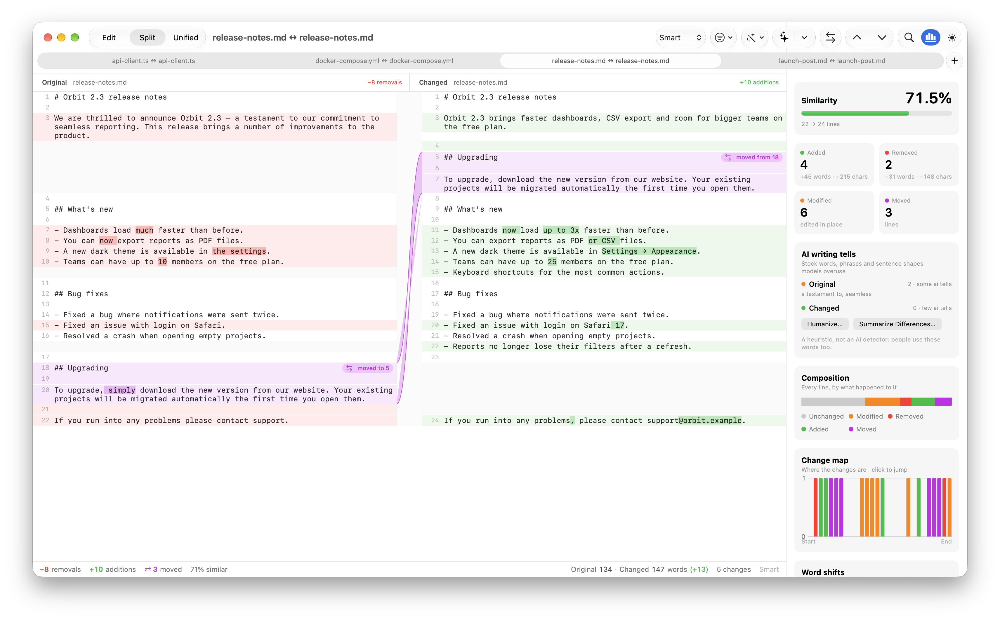
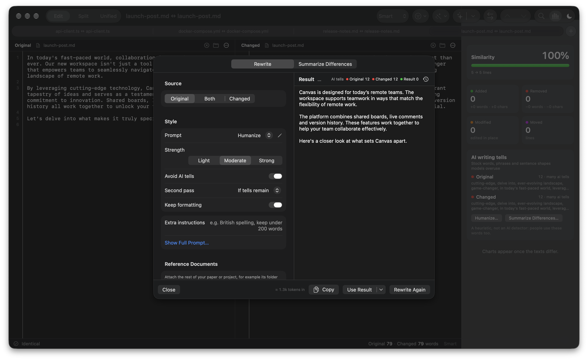
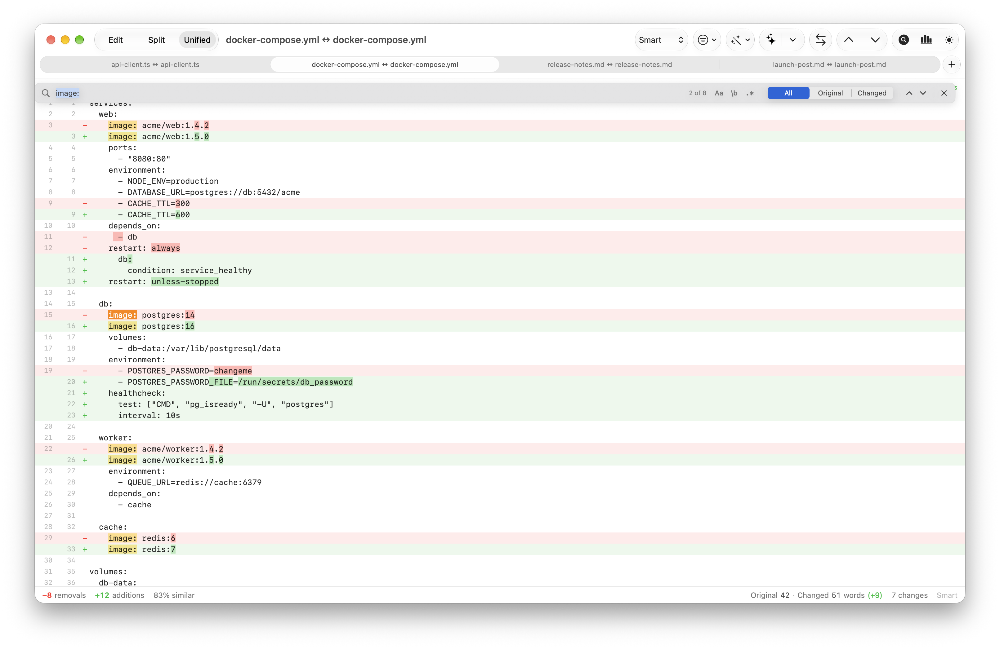

<p align="center">
  
</p>

<h1 align="center">Diffactly</h1>

<p align="center"><b>A free, fast, native macOS diff checker, with optional AI writing tools.</b></p>

Compare code, configs and documents with accurate line, word and character diffs, moved-block detection and live highlighting as you type. Keep several comparisons open in tabs and search both sides at once. When the writing itself needs work, bring your own AI model to humanize or rewrite a text, rewrite one passage in context, or summarize what changed. It works with OpenAI, Anthropic, Gemini and OpenRouter, or locally with Ollama, LM Studio and other servers on your Mac.

Diffactly is a free, open-source alternative to FileMerge, Kaleidoscope, Beyond Compare and online tools like Diffchecker: your text never has to leave your Mac to be compared.

## ✨ What's new

- **AI writing tools (optional)**: rewrite or humanize either text, blend both into one, rewrite just a selected passage so it still fits the document around it, or get a plain-language summary of the differences. Attach reference documents (say, the rest of a paper) for background. AI stays off until you add a provider in Settings, and with a local server nothing leaves your Mac
- **Tabs**: the tab bar is there from the first window, so the + (or ⌘T) opens another comparison right next to it. Tabs are named after their files, can be renamed with ⇧⌘R, and ⌘1–⌘9 jump between them
- **Find (⌘F)**: search the original, the changed text or both, with regex, whole-word and case options, and step through matches with ⌘G / ⇧⌘G, even inside collapsed unchanged lines
- **Connector ribbons**: the split view links moved paragraphs across the two sides and shows where a paragraph was split in two or two were merged
- **Name your panes**: double-click *Original* or *Changed* to rename it. The names follow through menus, word counts and exported patches
- **Clear** a side with its ⓧ button or ⌘K, or both with ⇧⌘K
- **Changed shortcuts**: Edit, Split and Unified views are now ⌃⌘1, ⌃⌘2 and ⌃⌘3, since ⌘1–⌘9 switch tabs

## Screenshots

**Review a code change** – side-by-side, with word- and character-level highlights inside edited lines, and each comparison in its own tab.



**Compare document revisions** – a ribbon follows the section that moved, and the optional Insights panel adds similarity, AI-writing tells, line composition and a clickable change map.



**Humanize AI-sounding text** – rewrite with your own model (here Mistral Small running locally in oMLX). The AI-tell count drops from 12 to 0, and *Use Result* puts the rewrite on the other side so you can see exactly what changed.



**Check a config change before you ship it** – a unified view in light mode, like `git diff` but readable, with Find (⌘F) highlighting every match.



## Features

- **Accurate diffs**: lines are aligned with a weighted algorithm that favours long, meaningful matches (re-indented lines still line up), and edited lines are paired by similarity so you see *what* changed inside them
- **Three precisions**: Smart (word diff, refined to single letters for typo-sized edits), Word, and Character
- **Moved-block detection**, including blocks that were moved *and* edited, with the edits highlighted. In the split view, ribbons connect moved paragraphs and paragraphs that were split or merged
- **Edit, Split and Unified views** (⌃⌘1–3): live highlighting while you type, or an aligned read-only comparison with collapsible unchanged lines and next/previous change navigation (⌃⌘↓ / ⌃⌘↑)
- **Find (⌘F)**: plain text, whole word, case-sensitive or regular expression, in both sides or just one, with ⌘G / ⇧⌘G to step through matches and ⌘E to search for the selection
- **Pane names**: double-click *Original* or *Changed* (or right-click it) to give a side its own name
- **Ignore options**: whitespace, case, quote style, dash style and custom strings
- **Transforms**: lowercase, sort lines, join lines, trim whitespace
- **Word counts**: live word totals for both texts (with the net change) in the status bar, plus the words and characters in your selection while editing
- **Insights (optional)**: toggle the chart button (⌥⌘I) for similarity, line composition, a clickable change map, word-frequency shifts and an AI-writing-tell count for each side
- **Open files** with ⌘O / ⇧⌘O, drag-and-drop, Finder's *Open With*, or `diffactly --gui`
- **Tabs**: the tab bar shows even with a single tab (hide it from View ▸ Hide Tab Bar), its + or ⌘T opens a new comparison tab, ⌘1–⌘8 jump to a tab (⌘9 to the last), ⇧⌘[ / ⇧⌘] cycle through them, and ⇧⌘R renames the current tab
- **Clear** a side with its ⓧ button or ⌘K (the focused side), or both with ⇧⌘K
- **AI rewrite (⌥⌘R)**: humanize, paraphrase, polish, shorten or restyle either text, or merge both into one version with a blend slider (like the original, an even mix, or like the changed text). Built-in prompts target the signs of AI writing (stock words like "delve" and "testament", "not just X but Y" contrasts, em-dash chains, summary endings) while keeping every fact. An optional second pass checks for lost facts and leftover tells, and an AI-tell counter scores each text. Write your own prompts in Settings, with `{{left}}`, `{{right}}` and `{{text}}` placeholders for full control. Put the result into either side to see exactly what changed. The second pass can run always or only when the scan still finds tells, and reasoning models show their thinking progress
- **Rewrite a selected passage (⌥⌘E)**: select text (or right-click a paragraph → *Rewrite Paragraph with AI*) and only that part is rewritten. The model reads the whole document around it, plus the other side if you like, so the new passage joins up, keeps the terminology and doesn't repeat what's nearby. Replace the selection in place (⌘Z undoes just that edit), or put an edited copy on the other side to compare. LaTeX is recognised, so commands, `\cite`/`\ref` keys, math and `~` ties stay as written
- **Reference documents**: attach supplementary files to a window's AI session, such as a paper's whole folder of `.tex` files, other open tabs, or pasted text. Every rewrite and summary then uses them as background for terms, notation and facts. Files are re-read when they change on disk, a file already open in the window isn't sent twice, and the block goes first in each request so providers can cache it (with an explicit cache breakpoint on Anthropic). The request size is shown against the model's context window when the server reports it
- **AI difference summary (⇧⌥⌘R)**: a model explains the main differences between the two texts, using the computed line diff so it reports real changes. Changed facts and numbers come first, then added, removed and moved content, an optional tone and style section, and which version suits what. Brief or detailed
- **Bring your own model**: OpenAI, Anthropic, Google AI Studio (Gemini), OpenRouter, or local servers via LM Studio, oMLX, Ollama, llama.cpp or any OpenAI-compatible endpoint. *Detect Local* finds running servers, and API keys are kept in the Keychain
- **Auto, Dark and Light modes**
- **Native**: SwiftUI + AppKit, no dependencies

## ⌨️ Command line

The same engine ships as a CLI (`DiffactlyKit/`, Swift package):

```sh
scripts/install-cli.sh            # builds and installs `diffactly`

diffactly old.txt new.txt             # coloured unified diff with inline highlights
diffactly -f split -l word a.md b.md  # side-by-side in the terminal
diffactly -f inline draft1 draft2     # [-removed-]{+added+} word diff
diffactly -s -g before.json after.json   # stats plus graphs (composition, change map, word shifts)
diffactly -f json a b                 # machine-readable result
diffactly -f patch a b | patch a      # valid unified patch
diffactly dirA dirB                   # compare folders recursively
diffactly --gui a b                   # open the comparison in Diffactly.app
git config --global diff.external "diffactly git"   # use Diffactly for `git diff`
```

Exit status follows `diff`: `0` same, `1` different, `2` trouble. Run `diffactly --help` for every option.

## 💻 Get it

Download the .app from the [releases](https://github.com/QuantumKuba/Diffactly/releases) page, or build it yourself by opening `Diffactly.xcodeproj` in Xcode.

Found a bug? Please [report it](https://github.com/QuantumKuba/Diffactly/issues).

## 🤝 Contributing

We welcome contributions! Here's how you can help:

1. Clone the repository
2. Create your feature branch (`git checkout -b feature/AmazingFeature`)
3. Commit your changes (`git commit -m 'Add some AmazingFeature'`)
4. Push to the branch (`git push origin feature/AmazingFeature`)
5. Open a Pull Request

Please ensure your PR:

- Follows the existing code style
- Includes appropriate tests
- Updates documentation as needed

## 📝 License

This project is licensed under the MIT License - see the [LICENSE](LICENSE) file for details.

## 🔗 Links

- Repository: [QuantumKuba/Diffactly](https://github.com/QuantumKuba/Diffactly)
- Report issues: [GitHub Issues](https://github.com/QuantumKuba/Diffactly/issues)
